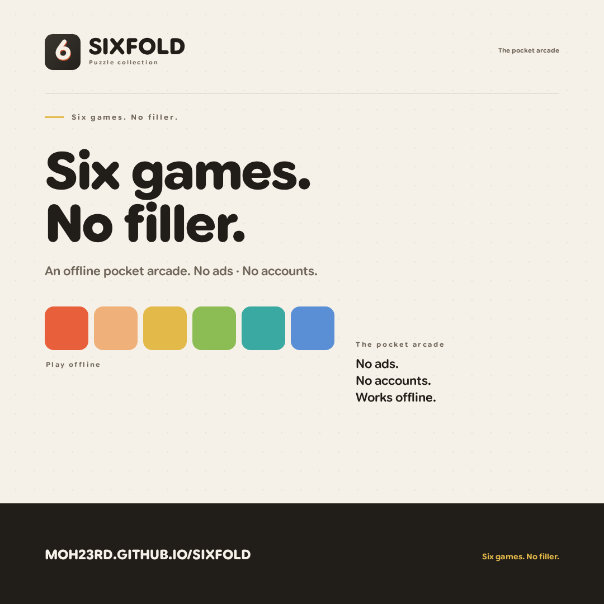

# Sixfold



Six calm puzzle games in one installable, offline web app. No accounts, no ads,
no tracking — and the interface runs in twelve languages.

**[Play Sixfold →](https://moh23rd.github.io/Sixfold/)**

## Games

- **Merge** — 2048 on a 4 × 4 board, with 3 × 3 and 5 × 5 variants.
- **Sudoku** — 9 × 9 in four difficulties, with notes, hints, undo and saved times.
- **Tic Tac Toe** — two players or three computer levels, up to an unbeatable one.
- **Minesweeper** — beginner, intermediate and expert fields with flags and chording.
- **Water Sort** — eight fixed levels, pour one colour at a time.
- **Fruit Merge** — a Suika-style drop-and-merge board with eleven fruits.

Every game saves its board, score and progress on the device. The daily challenge,
streaks, badges and Wordle (the hidden seventh game) all work offline too.

## Run it locally

```sh
npm ci
python3 -m http.server 8000     # then open http://localhost:8000
```

Serve over localhost: the service worker, offline cache and install prompt need a
real origin.

## Checks

```sh
npm test                  # Playwright: layout, games, accessibility, offline cache
npm run test:i18n         # catalogs and locale coverage
npm run test:webview-floor # ES2018 and Chromium 60 API floor
npm run audit:wordle      # dictionary provenance and policy
npm run test:death-report # Android launch death report, from recorded buffers
npm run test:reattach    # Android attach retry, without an emulator
npm run assets:icons:check # static launcher art and its pixel snapshots
npm run assets:manifest:check # shell content hashes
npm run test:cache-budget # shell bytes by asset class
```

The Android shell lives in `android/`; build and distribution notes are in
[docs/ANDROID.md](docs/ANDROID.md). Reproducible font, iOS launch image,
launcher-art and adaptive-icon builds are in [docs/ASSETS.md](docs/ASSETS.md).
[docs/](docs/) also holds the 6.0 roadmap and the Wordle audit and source
manifest.

## Layout

```text
index.html, licenses.html   hub, game screens and the licence page
css/                        one stylesheet per surface: shell, hub, games, polish
js/                         one script per game plus theme, sharing, daily, i18n glue
i18n/, fonts/, icons/, splash/, wordle-locales/   locale catalogs and bundled assets
sw.js                       offline shell and cache
docs/                       platform notes, roadmap, audit material
scripts/, tests/            audits and Playwright coverage
android/                    Capacitor Android project
```

Published with GitHub Pages from the `main` branch root. No build step.

## Licence and credits

Game code is [GNU GPL v3.0](LICENSE) (`GPL-3.0-only`). Google Sans Flex ships
under the [SIL Open Font License 1.1](fonts/OFL.txt). Full attributions are on
[licenses.html](licenses.html).

Wordle dictionaries are adapted from **Wordle Global**, **wordfreq**, **Wordle JP**
and **Wordle Kannada**; revisions and hashes are pinned in
[docs/WORDLE-SOURCES.json](docs/WORDLE-SOURCES.json). Release history is in
[CHANGELOG.md](CHANGELOG.md).

Questions or bug reports: [mohrd9685@gmail.com](mailto:mohrd9685@gmail.com).
